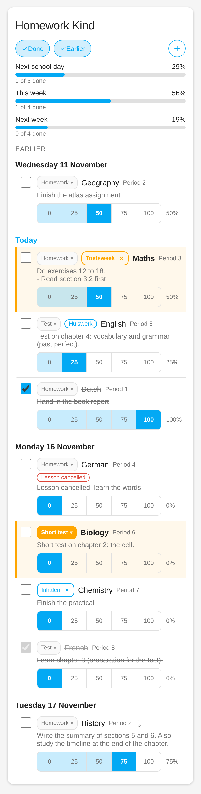
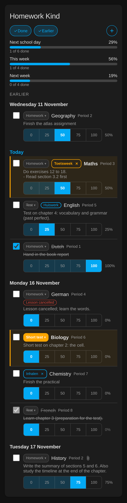

# Magister for Home Assistant

[Nederlands](README.nl.md) | English

Show your child's school agenda from [Magister](https://www.magister.nl/) in Home Assistant:
one calendar per child, plus optional sensors with the start time of the first appointment of
a day (handy for a wake-up alarm).

> **Unofficial.** This project is not affiliated with, endorsed by or supported by Iddink or
> Magister. It signs in the way a browser does, so it may stop working when Magister changes its
> login. Use it at your own risk.

## What you get

- A calendar **Agenda** for every child (device `Kind (myschool)`), with lessons, homework,
  tests, cancelled lessons and school events. By default from one week back to three weeks
  ahead, refreshed every 30 minutes (both adjustable).
- A **Homework** to-do list and three progress sensors per child (see the homework planner).
- Optional **first-appointment sensors** (a timestamp) for automations.
- Event titles come from Magister (in Dutch) with these labels:

| Title | Meaning |
|---|---|
| `[Vervallen] wiskunde` | cancelled lesson |
| `[Huiswerk] wiskunde` | lesson with homework |
| `[Proefwerk]`, `[Tentamen]`, `[SO]`, `[MO]`, `[Informatie]` | test, exam, written/oral quiz, information |

Labels combine, for example `[Vervallen] [Huiswerk] scheikunde`. Labels you add yourself in the
homework planner (see below) follow the Magister label: `[Proefwerk] [Toetsweek] wisB`. When Magister gives no subject, the first part of the appointment's description is used as the
title (and `Afspraak` if that is empty). The event description shows the lesson hour, a note
for moved or cancelled lessons, the teachers and the homework text.

## Requirements

- Home Assistant **2026.10.4** or newer.
- A Magister account of a parent or student with a **username and password**. Accounts that
  can only sign in through school SSO (Entree, Microsoft, Google) or a passkey are not supported.
- Only if the account uses two-step verification (an authenticator app): the **authenticator
  secret**. This is the base32 text (letters and digits) that Magister shows next to the QR code
  when you set up the authenticator app. Magister shows it only during setup, so you probably
  have to set up the authenticator again (a new QR code and secret) and note the secret. The
  new secret replaces the old pairing: also add it to your own authenticator app.

## Installation

### With HACS (recommended)

1. Install HACS first if you have not done so: follow the official guide,
   <https://hacs.xyz/docs/use/download/download/> (in Home Assistant 2026.2 and later add-ons are
   called *apps*).
2. In HACS open the three-dot menu and choose **Custom repositories**.
3. Enter `https://github.com/michielmj/ha_magister` and choose type **Integration**, then **Add**.
4. Search for **Magister** in HACS, choose **Download** and restart Home Assistant.
5. Refresh your browser (a hard refresh) so the new integration and its icon show up.

### Manually

Copy the folder `custom_components/magister` from this repository to
`config/custom_components/magister` in Home Assistant, restart Home Assistant and refresh the browser.

## Setup

1. Go to **Settings > Devices & services > Add integration** and choose **Magister**.
2. Enter the school (`myschool`, `myschool.magister.net` or the web address), the username and
   the password. With two-step verification also enter the authenticator secret.
3. For a parent account choose the children that should get a calendar.

Each Magister login is one entry. Several logins are fine, also at the same school and for
different schools, as long as each child is added under one login only (two parents: add each
child once). The setup and **Configure** hide children that are already added under another
login of the same school. The same account cannot be added twice.

### Options

**Configure** on the integration page opens a menu: **General settings** changes the children, the weeks back (0 to 8), the
weeks ahead (1 to 12) and the refresh interval (15 to 360 minutes). Saving reloads the
integration without a new password login, as long as the session is still valid. Adding a child
adds a calendar, a homework list and progress sensors (first-appointment sensors you add yourself); removing a child removes all of them. **Homework weights** and **Labels** are described under the homework planner.

## First-appointment sensors

Nothing is created automatically. On the integration page choose **Add first-appointment
sensor** (next to **Configure**):

1. Choose the child and the day offset (0 = today, 1 = tomorrow, ...). The day must lie
   inside the fetched window: at most `7 x weeks ahead - 1` days ahead (20 with the default of 3
   weeks).
2. Choose the subjects that do not count, for example `Franse taal`. The list shows subjects in
   the child's current agenda and you can type other names. A subject matches when the whole name
   is equal, ignoring upper and lower case.

The sensor (device class `timestamp`, on the child's device, for example
`sensor.kind_myschool_eerste_afspraak_vandaag`) shows the start of the first timed appointment of
that day that is not cancelled and not excluded. Lessons, school exams and school events count;
all-day items do not. Attributes: `date`, `end`, `subject`, `summary`, `location`,
`lesson_hours` and `skipped` (the number of cancelled or excluded items before it).

The state is **`unknown`** when there is no such appointment (weekend, holiday, everything
cancelled or excluded) or when the offset no longer fits the window (a repair notice then explains
this). The offset counts calendar days, so on Friday offset 1 is Saturday. The sensor updates with
each refresh and at midnight, without extra requests to Magister. Every sensor can be edited
(reconfigure) and deleted separately.

### Automation examples

The sensor is a timestamp, so the **Time** trigger can fire relative to it. An alarm 1 h 30 min
before the first lesson of today (sensor with offset 0):

```yaml
triggers:
  - trigger: time
    at:
      entity_id: sensor.kind_myschool_eerste_afspraak_vandaag
      offset: "-01:30:00"
actions:
  - action: script.wake_up
```

For an early lesson you may want the alarm the evening before: use the "tomorrow" sensor (offset
1) with a large negative offset, for example `"-14:00:00"` (14 hours before the first lesson of
tomorrow).

Rule of thumb: pick the sensor whose day is the target day at the moment the trigger fires. A
"today" sensor rolls over to the next day at midnight, so an alarm at 06:45 for today's lesson
belongs on the offset 0 sensor and an alarm the evening before on the offset 1 sensor.

**Add a fallback for important alarms.** The sensors and calendars keep the last good data for up
to 24 hours when Magister or your internet connection is down, so a short outage does not cancel a
scheduled alarm. After 24 hours without a successful refresh they become unavailable. For a first
lesson you must not miss, also add a fixed-time alarm as a fallback.

## Homework planner (to-do list and progress sensors)

Each child also gets a **Homework** to-do list (`todo.kind_myschool_homework`) and three
progress sensors. The items are the homework and test items of the agenda in the fetched window
(Magister's *Huiswerk*, *Proefwerk*, *Tentamen*, *SO* and *MO*; information items are left out),
plus every appointment that has at least one **manual label** (see below). Homework on a
cancelled lesson is shown, marked `Les vervallen`.

- **To-do list.** The title is `[Huiswerk] wiskunde`, the due date is the lesson, the description
  holds the homework text. Tick an item (in the to-do view, the mobile app, by voice or in an
  automation) to set it to 100 %; untick it to restore the last value below 100 %. Items cannot
  be added, renamed or deleted: they come from Magister. **The number Home Assistant shows for the
  list counts only the open items due today or later.** Past homework stays in the list and on the
  card, but is not counted. The count moves on at midnight (Europe/Amsterdam). Automations and
  conditions on the list's state use this count (overdue items are not counted).
- **Progress** is a percentage per item (0 to 100) and is stored in Home Assistant only. Nothing
  is written to Magister. It survives restarts and refreshes, and it is kept when Magister
  changes the homework text. Progress of items that left the fetched window is removed after
  14 days. Set it with the service `magister.set_homework_progress` (target the to-do entity;
  fields `item`, the item's `uid`, and `progress` 0 to 100):

```yaml
action: magister.set_homework_progress
target:
  entity_id: todo.kind_myschool_homework
data:
  item: "myschool.magister.net:1001:100065"
  progress: 50
```

- **Progress sensors** (`Homework next school day`, `Homework this week`, `Homework next week`,
  unit %): the weighted average progress of the items due in that period. School days are Monday
  to Friday. **Next school day** covers all of today's items plus those of the next school day
  (on Friday, Saturday and Sunday that is Monday). **This week** is Saturday to Friday, including
  the days already past (on a Saturday it is the coming school week); **next week** is the
  following Saturday to Friday. Since 1.3.0 the first sensor was renamed from "Homework tomorrow":
  its entity id and history are kept, only the name changed. **With nothing due the
  value is 100 %**; the attribute `items: 0` tells that apart from "all done". Attributes:
  `items`, `completed`, `open`, `tests` (tests and quizzes), `period_start`, `period_end` and
  `weights` (the weights in use). For the next-school-day sensor `period_start` and
  `period_end` span the whole range, including the free weekend days, which are not counted. With 0
  weeks back the weekend before this Monday lies outside the fetched window (no practical effect).
  The sensors update on every change, each refresh and at
  midnight, without extra requests to Magister, and follow the 24 hour availability rule.
  "Next week" needs at least 2 weeks ahead; with 1 week ahead that sensor is unavailable and a
  repair notice explains it.
- **Weights.** In **Configure > Homework weights** choose a child and set a weight (0 to 10, steps
  of 0.5, default 1) per type, per manual label and per subject. An item counts with
  `label weight x subject weight`, where an item with several labels (its Magister type and any
  manual labels) uses the highest label weight; a weight of 0 leaves the item out of the average (it stays in the
  list). Only values other than 1 are saved. Subjects are matched on the whole name, ignoring upper
  and lower case; weights of subjects that are not in the data right now are kept. Changing
  weights does not reload the integration.
- **Manual labels.** Besides Magister's labels you can put your own labels on any lesson of the
  fetched window, for example *Toetsweek* or *Inhalen*. A labelled lesson becomes a homework item
  even when Magister has no homework or test for it, and it can carry an optional short note
  (at most 200 characters). A lesson may have a Magister label and manual labels; **only manual
  labels can be removed**. A label of the kind *test* makes the item count as a test. Manual labels
  are stored in Home Assistant only, are kept while the appointment exists and are removed 14 days
  after it has gone. They also appear in the calendar title after the Magister label.
  - **Configure > Labels:** choose a child, then add a label (name and kind: homework or test),
    rename it or change its kind, or delete it. The list starts with the five Magister names
    (Huiswerk is *homework*, the others *test*). A label that is still on a lesson cannot be
    deleted. Changing labels does not reload the integration. Set the weight of a custom label
    under **Homework weights**; the five Magister names use the type weights (also when
    renamed). Label names cannot contain `[` or `]`.
  - **Services** `magister.add_homework_label` (fields `appointment`, `label`, `note`) and
    `magister.remove_homework_label` (fields `appointment`, `label`) target the to-do entity.
    `appointment` is the item uid (`host:childId:appointmentId`), `label` the label's id or its
    name (not case-sensitive):

```yaml
action: magister.add_homework_label
target:
  entity_id: todo.kind_myschool_homework
data:
  appointment: "myschool.magister.net:1001:100070"
  label: Toetsweek
  note: "H3 + H4"
```

- **Replacing or disabling a Magister label** (since 1.4.0). Sometimes a teacher puts *Proefwerk*
  on a lesson that only prepares for a test. You can **replace** the Magister label of a lesson
  with one of the child's label options, **disable** it, and always **restore** it; nothing is
  written to Magister. A replacement makes the item count with the replacement's kind and weight
  (a test highlight and the `tests` count follow it), and the calendar title shows
  `[Proefwerk→Huiswerk]`. A disabled label counts as completed: the item is listed among the
  completed ones, is not in the to-do count, has weight 0 and is ignored by the bars and
  sensors; its progress is kept and comes back on restore. If the lesson also has an active
  manual label, the item stays active and its weight comes from the active labels. An item's
  weight is always the highest weight of its active labels times the subject weight. In
  Home Assistant's own to-do view a disabled item shows as completed and cannot be ticked
  (restore it first). A label option that is used as a replacement on a lesson cannot be
  deleted. Use the card (see below) or the service `magister.set_homework_override` (fields
  `appointment`, `mode`: `replace`, `disable` or `clear`, and for replace `label`, id or name):

```yaml
action: magister.set_homework_override
target:
  entity_id: todo.kind_myschool_homework
data:
  appointment: "myschool.magister.net:1001:100084"
  mode: replace
  label: Huiswerk
```

## Homework planner card

The integration ships its own Lovelace card, **Magister Homework planner**, one per child. It is
loaded automatically (no resource to add by hand, also not with HACS) and shows the homework
and tests of the child's Homework to-do list, grouped per day, with a progress control per item.

<p>
  
  
</p>

**Add it:** open a dashboard, choose *Edit dashboard > Add card*, search for **Magister** and pick
*Magister Homework planner*. Choose the child's Homework list in the visual editor.

| Option | Default | Meaning |
|---|---|---|
| `entity` | (required) | The child's Homework to-do list (a `todo.` entity of Magister) |
| `title` | none | Card title |
| `language` | `auto` | Card language: `auto` (the Home Assistant language), `nl` or `en`. All texts and dates follow it |
| `show_completed` | `false` | Start position of the "Done" switch: also show completed items (they can be unticked) |
| `show_past` | `false` | Start position of the "Earlier" switch: also show days before today, in an "Earlier" section |
| `card_id` | generated | Made once by the visual editor; keeps the remembered switches of this card apart (see below) |
| `days_ahead` | `7` | Show items up to this many days after today (that day included) |
| `show_progress_tomorrow` | `false` | Bar with the progress for the next school day above the homework (the key keeps its old name) |
| `show_progress_week` | `false` | Bar with the progress for this week (Saturday to Friday) |
| `show_progress_next_week` | `false` | Bar with the progress for next week |

```yaml
type: custom:magister-homework-card
entity: todo.kind_myschool_homework
title: Homework Kind
show_completed: false
show_past: false
days_ahead: 7
show_progress_tomorrow: true
show_progress_week: true
show_progress_next_week: false
```

- **Progress bars.** Each enabled bar shows the same value as the matching progress sensor (the
  weighted average, whole percent), with "3 of 5 done" below it, or "no homework" at 100 % when
  nothing is due. A bar shows "not available" while the sensor is unavailable (for instance next
  week with 1 week ahead). The bars update as soon as you tick an item; they use your theme colours.
- Per day: "Today", "Tomorrow", then the weekday and date. Tests (Proefwerk, Tentamen, SO, MO) are
  highlighted. Lessons that were cancelled are marked, and so is an attachment in Magister (the
  files themselves are not available here).
- **Tick** an item to mark it done (100 %); **untick** it to go back to the progress it had before.
  Or tap a step (0, 25, 50, 75, 100 %). The text of an item shows two lines; tap it for the rest.
- The card updates by itself. When Magister has been unreachable for more than 24 hours the last
  items are greyed out and cannot be changed. If saving fails, the change is rolled back and a
  message appears.
- Texts follow your Home Assistant language (Dutch or English) unless you set `language`; colours
  follow your theme.
- **Switches.** The header has two toggle buttons, **Done** and **Earlier**, that show or hide
  completed items and earlier days. The config sets where they start; what you choose on the card is
  remembered **per browser** (localStorage, per card). Saving a changed card configuration resets
  them to the configured values. Without browser storage (a private window, for example) the
  switches still work but are not remembered. A card you duplicate (or paste as YAML) shares the
  `card_id` and so the remembered switches of the original; remove `card_id` from the copy's YAML
  to give it its own.
- **Adding a label.** The **+** button in the header (shown when the child has label options and
  Magister is available) opens a dialog: pick a day, pick one of its lessons, pick a label (set
  under *Configure > Labels*, with its kind shown) and optionally type a note, then *Save*. The
  dialog works with the keyboard (Escape closes it) and on a phone. Days outside the fetched window
  are refused with a message.
- **Manual labels on the card.** Next to Magister's label an item shows its manual labels as
  outlined chips, with the note as text under the homework text. Only manual chips have an **×**;
  it asks for confirmation and then removes the label (Magister's labels cannot be removed). If
  saving fails, the change is rolled back and a message appears.
- **Replacing or disabling a Magister label.** The Magister chip is a button (when Magister is
  available) that opens a small menu: *Replace with…* (the child's label options, except the
  lesson's own label), *Disable* and, when changed, *Restore*. It works with the keyboard (arrow
  keys, Escape) and on a phone. A changed chip is struck through, followed by the replacement
  chip (without ×; restoring goes through the menu). Disabled items are listed with the completed
  ones (switch **Done** on), struck through, with their controls disabled; the menu offers
  *Restore*. Changes show at once and are rolled back with a message if saving fails.
- An item you tick off stays visible until you reload the dashboard, so you can undo a slip.

## How it behaves

- Refresh every 30 minutes by default; the whole window is fetched in one go.
- During an outage the data stays available for up to 24 hours, then it becomes unavailable.
- Cancelled lessons stay visible with `[Vervallen]` and are skipped by the sensors.
- Moved lessons get a note in the description.
- Only the school agenda is read. Nothing is written to Magister.

## Troubleshooting

- **Re-authentication required** (card on the integration page): the login stopped working,
  usually after a password change. Enter the new password (and a new authenticator secret only if
  it changed). The integration then logs in exactly once. To change the username or secret on
  purpose, use **Reconfigure** in the three-dot menu of the entry. Both only accept the same
  Magister account.
- **Login blocked / "Logging in to Magister is blocked after repeated failures"**: to avoid
  locking your account, the integration stops trying after repeated failures. Fix the cause
  (password, network), then **reload** the integration (three-dot menu): that tries one more
  time. If the password is wrong, use Reconfigure or the re-login card instead.
- **Repair "Magister changed its login page"**: Magister changed its sign-in pages. Update the
  integration in HACS; if it persists, open an issue.
- **Repair "Several logins list the same child"**: a child is configured under more than one
  login of the same school (possible with installs from before this check). Open **Configure** on
  one of those logins and deselect the child.
- **Repair "First-appointment sensor outside the window"**: a sensor looks further ahead than the
  weeks ahead allow. Increase **Weeks ahead** or edit the sensor.
- **Logs**: Settings > System > Logs, filter on `magister`. For more detail add this to
  `configuration.yaml` and restart:

  ```yaml
  logger:
    logs:
      custom_components.magister: debug
  ```

- **Diagnostics**: on the integration page, three-dot menu, **Download diagnostics**. The file
  contains options, counts and the login state; usernames, passwords, secrets, tokens, names, ids
  and the school host are removed.

**Never post names, screenshots that show names, or passwords in an issue.** Attach the
diagnostics file instead and replace anything personal in logs by hand.

### Command-line check

[`tools/magister_cli.py`](tools/README.md) tests the login and agenda from your own computer,
without Home Assistant, and can write an anonymized dump. Read [`tools/README.md`](tools/README.md)
first; the password is asked with hidden input.

## Privacy and security

- Your username, password and authenticator secret are stored in Home Assistant's config entry
  (`config/.storage`), like other integrations. Protect your backups.
- They are never written to logs; diagnostics redact them.
- Data goes only between your Home Assistant and Magister (your school's Magister server and
  login service). There is no other server, no analytics.
- Lockout protection: after a failed login or repeated server errors the integration waits and
  does not retry with the password; it stops completely when it could count towards a lockout,
  until you reload the integration or re-authenticate.

Report security problems privately, see [SECURITY.md](SECURITY.md).

## Development

Design and planning documents are in [`docs/`](docs/). The Homework planner card is built from
[`frontend/`](frontend/) (`npm ci && npm run build`); the built bundle in
`custom_components/magister/frontend/` is committed, and CI fails when it does not match the source. Maintainer: `michielmj`. License: MIT.
